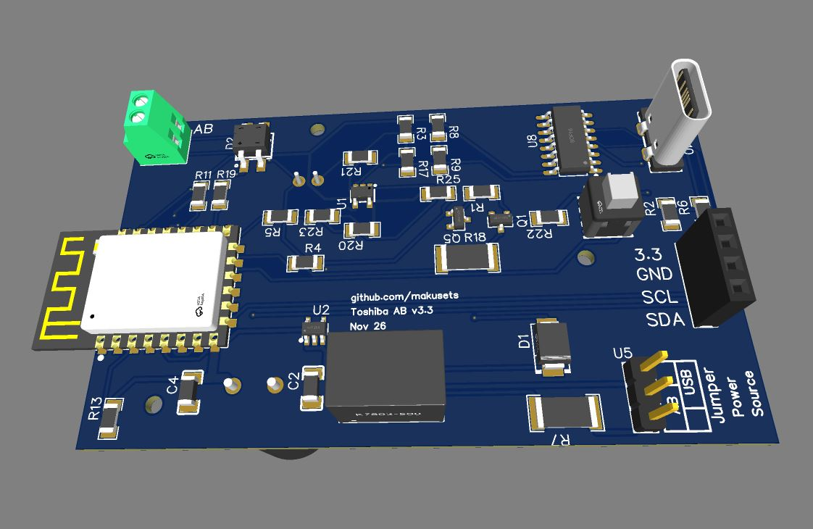
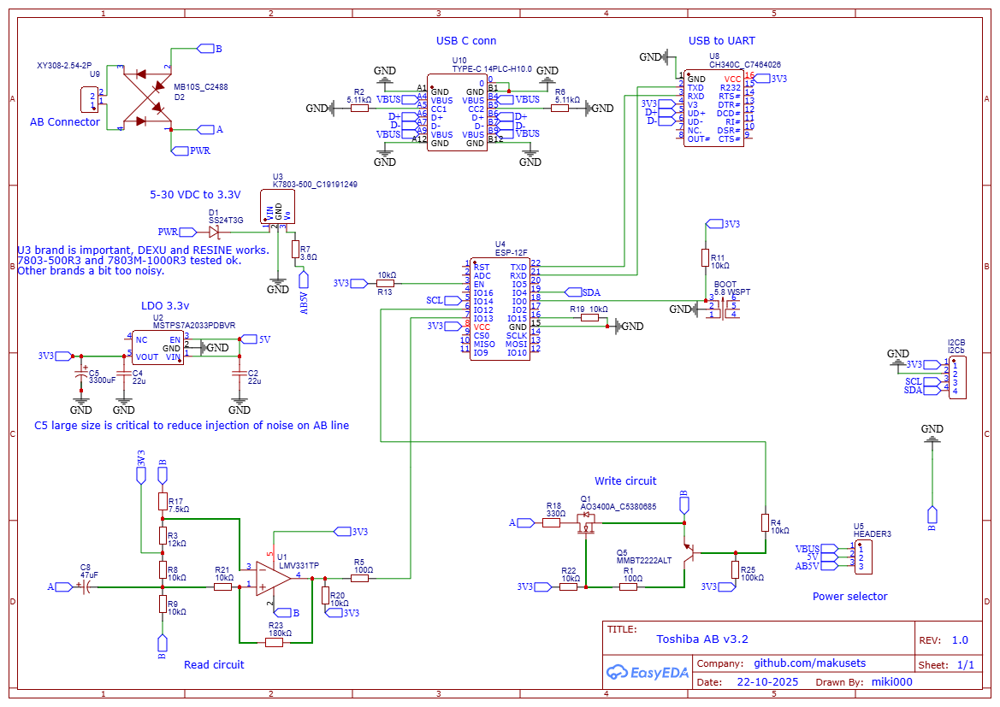

# v3.3 — November 2026

## Ordering or building the board

v3.3 is the DIY-soldering version of the Toshiba AB interface, based on the
[v3.3_SMD design](../v3.3_SMD/README.md). It combines through-hole and SMD parts
to make hand assembly easier. Some SMD soldering is still required; choose
v3.3_SMD if you prefer to order a board designed for factory assembly.

Compared with earlier designs, v3.3:

- improves noise filtering and introduces less noise onto the AB line;
- adds a **3.6 Ω series limiting resistor (R7)** in the 3.3 V supply path,
  ahead of the large **3300 µF reservoir capacitor (C5)**, reducing the noise
  coupled back onto the AB line;
- tolerates a wider choice of DC/DC buck converter brands, although **RESINE
  and DEXU remain the recommended options**;
- keeps the v3.2 pin assignment and ESPHome configuration: UART TX `GPIO12`,
  RX `GPIO13`.

Unlike v3.3_SMD, this version uses the **BOOT button for initial USB flashing**.

### Files for ordering

This folder contains the fabrication files and editable EasyEDA project:

| File | Purpose |
| --- | --- |
| [Gerber_v3.3.zip](Gerber_v3.3.zip) | PCB fabrication. This is all you need to order bare boards for hand assembly. |
| [BOM_v33.csv](BOM_v33.csv) | Bill of materials for sourcing components or arranging assembly. |
| [PickAndPlace_v3.3.csv](PickAndPlace_v3.3.csv) | Component positions and rotations for factory assembly. |
| [Schematic_v3.3.png](Schematic_v3.3.png) | Circuit schematic. |
| [v3_3_project.zip](v3_3_project.zip) | Editable EasyEDA project archive. |

For a DIY build, upload the Gerber archive to a PCB manufacturer and order bare
boards. Source the components using this revision's BOM and schematic. If you
choose partial or factory assembly, also supply the BOM and pick-and-place file,
check which through-hole parts the service can fit, and review the assembly
preview for missing components and correct orientation.

The EasyEDA project archive contains another ZIP archive. Extract the outer ZIP
and import the project archive inside it into EasyEDA to inspect or modify the
schematic and PCB.

### Component shortfall

If a component is unavailable, use the manufacturer's parts-sourcing service or
choose an equivalent with the correct footprint, pinout and electrical ratings.
The improved supply filtering makes v3.3 more tolerant of buck converter choice
than earlier revisions, but **RESINE or DEXU** converters are recommended. The
schematic notes tested **7803-500R3 and 7803-1000R3** options; check the required
pinout and footprint before substituting a converter.

Retain the specified **3.6 Ω R7** and the large **3300 µF C5** capacitor: both
are part of the supply filtering that reduces noise injected onto the AB line.

## DIY assembly

Use the schematic, BOM and board markings to identify components and their
orientation. Fit the small SMD parts while they remain accessible, followed by
the through-hole parts, connectors and modules. The design is intended for hand
soldering, but it still includes small SMD devices.

The two through-hole electrolytic capacitors are:

- **C5: 3300 µF**, the 3.3 V rail reservoir capacitor.
- **C8: 47 µF**, in the read circuit.

Both are listed in this revision's BOM. Match the specified footprints and
voltage ratings, and observe the polarity shown on the schematic and PCB.
If ordering partial assembly, check whether these capacitors, the buck converter
and the connectors are included or need to be sourced and soldered yourself.

## Flashing and installation

Use the same ESPHome pin settings as v3.2: TX `GPIO12` and RX `GPIO13`. Choose
UART parity and frame format for your Toshiba system; these settings depend on
the system rather than the board revision. No firmware pin changes are needed
when moving from v3.2 or v3.3_SMD.

For the first flash, leave the A/B wires disconnected and select **USB** power
with all power removed. Hold **BOOT** while connecting a data-capable USB cable
to enter flashing mode, then install ESPHome through the dashboard or CLI.
Unlike v3.3_SMD, the v3.3 USB serial circuit does not enter flashing mode
automatically. Later updates can be installed over Wi-Fi.

Follow the [main installation instructions](../../README.md#start-here-flash-and-connect-the-board)
and [hardware guide](../../docs/hardware.md) for connecting the board in parallel
with the wired controller. Disconnect USB and isolate the HVAC system before
connecting A/B. Select **AB** power before normal operation from the bus.

## Schematic

## Boards on eBay

If you prefer a finished board, check the [boards on eBay](https://www.ebay.com.au/usr/zaurak_trade).

[Back to the main README](../../README.md) · [v3.3_SMD design](../v3.3_SMD/README.md) · [v3.2 design](../v3.2/README.md)
