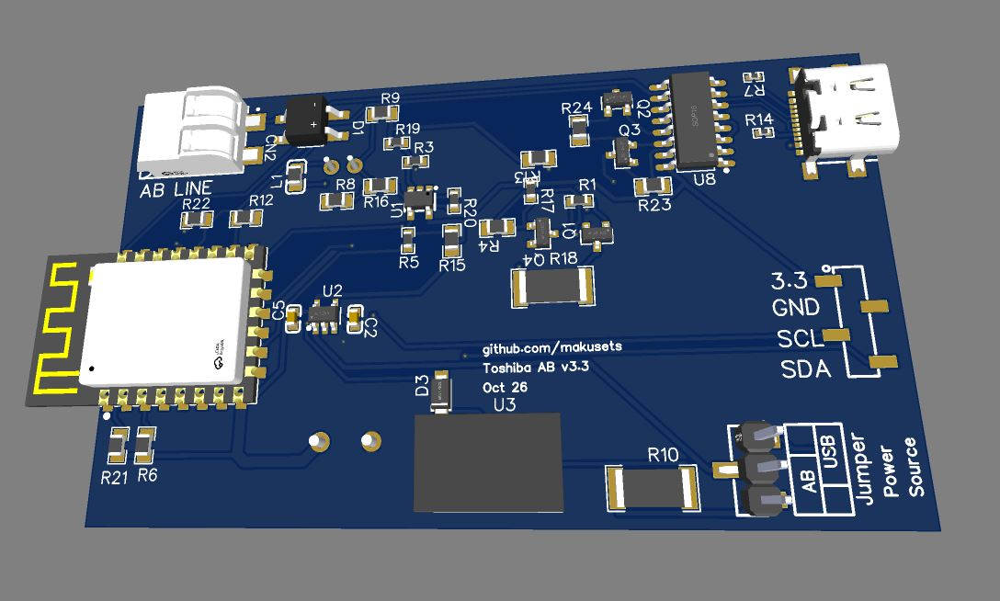
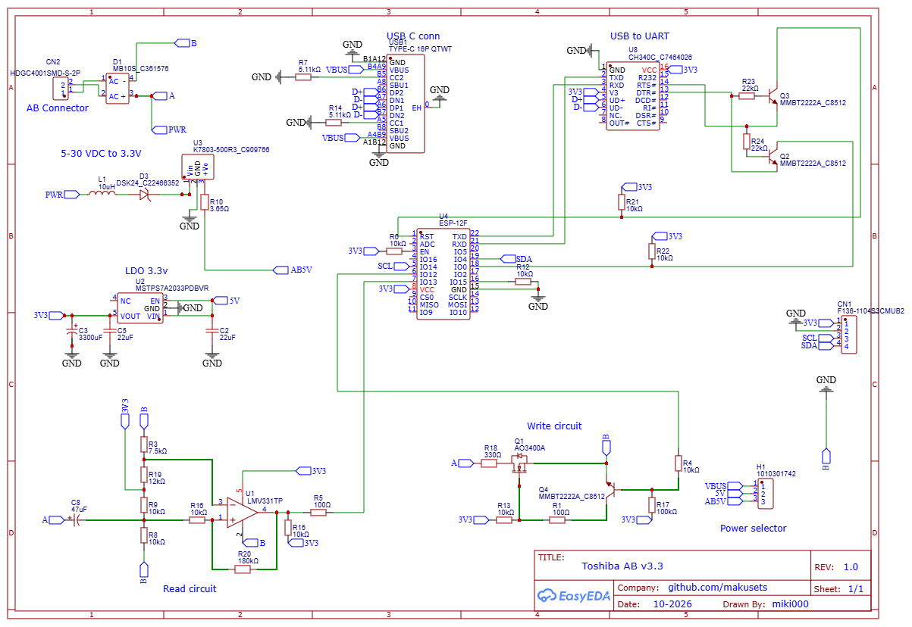

# v3.3_SMD — October 2026

## Ordering or building the board

v3.3_SMD is a revision of the Toshiba AB interface aimed at people who want to
order the board assembled by a PCB manufacturer such as JLCPCB. Components have
been chosen to reduce assembly cost compared with previous versions. The design
uses SMD components except for two through-hole electrolytic capacitors, which
the end user is expected to source and solder by hand.

Compared with v3.2, this version:

- costs less to order assembled;
- enters flashing mode automatically over USB, without pressing a boot button;
- introduces less electrical noise into the AB circuit;
- uses the same pins and is functionally equivalent to v3.2, so the same ESPHome
  configuration can be used: UART TX `GPIO12`, RX `GPIO13`.

At the last price check, two boards with factory assembly could be ordered for
approximately **AUD 120 / EUR 75, including shipping**. The two electrolytic
capacitors still need to be fitted by hand. This is an indicative price; the
current quote depends on component availability, destination and assembly options.

### Files for ordering

This folder contains the fabrication files and editable EasyEDA project:

| File | Purpose |
| --- | --- |
| [Gerber_v3.3-SMD.zip](Gerber_v3.3-SMD.zip) | PCB fabrication. This is all you need if ordering bare boards. |
| [BOM_v3.3-SMD.csv](BOM_v3.3-SMD.csv) | Bill of materials for factory assembly. |
| [PickAndPlace_v3.3-SMD.csv](PickAndPlace_v3.3-SMD.csv) | Component positions and rotations for factory assembly. |
| [Schematic_v3.3-SMD.png](Schematic_v3.3-SMD.png) | Circuit schematic. |
| [v3_3_SMD.zip](v3_3_SMD.zip) | Editable EasyEDA project archive. |

Upload the Gerber archive to the manufacturer and select PCB assembly. Supply
this revision's BOM and pick-and-place file, then check that all components you
want assembled are selected. Review the assembly preview for missing parts and
correct orientation before placing the order.

The EasyEDA project archive contains another ZIP archive. Extract the outer ZIP
and import the project archive inside it into EasyEDA to inspect or modify the
schematic and PCB.

### Component shortfall

If a component is out of stock, use the manufacturer's parts-sourcing service or
choose a suitable equivalent. Check the footprint, pinout and electrical ratings
against the schematic. In particular, changing the DC/DC converter or filtering
components can affect noise on the AB line; use the specified parts where possible.

## Finishing the board

Solder the two through-hole electrolytic capacitors yourself:

- **C3: 3300 µF**, on the 3.3 V rail.
- **C8: 47 µF**, in the read circuit.

These capacitors are not included in the supplied assembly BOM. Source suitable
parts for the PCB footprints and circuit voltage ratings, and follow the
polarity shown on the schematic and board markings. Fit them before powering
and using the board.

## Flashing and installation

Use the same ESPHome settings as v3.2, including TX `GPIO12` and RX `GPIO13`.
Choose the UART parity and frame format appropriate for your Toshiba system;
these settings depend on the system rather than the board revision.

For the first flash, leave the A/B wires disconnected, select **USB** power with
all power removed, and connect a data-capable USB cable. Install ESPHome through
the dashboard or CLI. **No boot-button press is required on v3.3_SMD:** the USB
serial circuit handles entry into flashing mode automatically. Later updates
can be installed over Wi-Fi.

Follow the [main installation instructions](../../README.md#start-here-flash-and-connect-the-board)
and [hardware guide](../../docs/hardware.md) for connecting the board in parallel
with the wired controller. Disconnect USB and isolate the HVAC system before
connecting A/B or changing the power selector. Select **AB** power before normal
operation from the bus.

## Schematic

## Boards on eBay

If you prefer a finished board, check these listings for the available revision
and what is included:

- [1 board on eBay](https://www.ebay.com.au/itm/307132294608)
- [2 boards on eBay](https://www.ebay.com.au/itm/307132302164)

[Back to the main README](../../README.md) · [v3.2 design](../v3.2/README.md)
